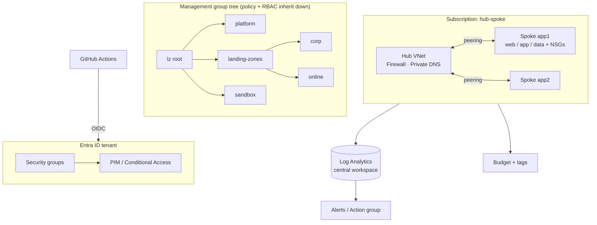

# Azure Landing Zone Lab (Terraform + GitHub Actions)

A hands-on course in building an Azure **landing zone** with Terraform: management groups,
hub-spoke networking, segmentation, Entra ID identity and federation, policy, logging,
monitoring and cost governance — deployed through a GitHub Actions pipeline that
authenticates with **OIDC (no stored secrets)**.

Every module is small and commented. Every lesson in [`docs/`](docs) explains the *why*,
tells you what to apply, how to verify it, and gives you an exercise.



## Learning path

| # | Lesson | Terraform module | Cost |
|---|--------|------------------|------|
| 1 | [Foundations, state & OIDC bootstrap](docs/01-foundations-and-bootstrap.md) | `bootstrap/` | ~free |
| 2 | [Management groups & subscriptions](docs/02-management-groups.md) | `modules/management-groups` | free |
| 3 | [Hub-spoke architecture](docs/03-hub-spoke.md) | `hub-network`, `spoke-network` | VNets free; **Firewall ≈ $1.25/hr** |
| 4 | [Network segmentation](docs/04-segmentation.md) | NSGs, UDRs, firewall rules | – |
| 5 | [Identity & Entra ID federation](docs/05-identity-entra.md) | `modules/identity` | P1/P2 for some features |
| 6 | [Policy enforcement](docs/06-policy.md) | `modules/policy` | free |
| 7 | [Logging & monitoring](docs/07-logging-monitoring.md) | `logging`, `monitoring` | pay per GB (capped) |
| 8 | [Cost governance](docs/08-cost-governance.md) | `modules/cost` | free |
| 9 | [CI/CD with GitHub Actions](docs/09-cicd.md) | `.github/workflows` | free |
| 10 | [Next steps & production gaps](docs/10-next-steps.md) | – | – |

## Prerequisites

- An Azure subscription (a personal/dev one — **not production**) and a tenant where you can
  be **Global Administrator** (a free [Microsoft 365 developer tenant](https://developer.microsoft.com/microsoft-365/dev-program) works).
- Tools: Terraform ≥ 1.9, Azure CLI, GitHub CLI (`gh`), git.
- ~$5–20 for a weekend if you destroy the firewall when finished.

## Quick start

```bash
# 0. Push this repo to your GitHub
git remote add origin git@github.com:<you>/azure-landing-zone-lab.git   # or: gh repo create ... --source=. --push
git push -u origin main

# 1. Log in and elevate (needed to create management groups / root-scope RBAC)
az login
# Entra admin center > Properties > "Access management for Azure resources" = Yes
az role assignment create --assignee $(az ad signed-in-user show --query id -o tsv) \
  --role "User Access Administrator" --scope "/"

# 2. Bootstrap state storage + GitHub OIDC identity
cd bootstrap
cp terraform.tfvars.example terraform.tfvars   # edit values
terraform init && terraform apply
terraform output -raw github_setup_commands | bash   # sets GitHub repo variables
terraform output -raw backend_hcl > ../envs/lab/backend.hcl

# 3. Deploy the landing zone locally (first time), then via PRs
cd ../envs/lab
cp terraform.tfvars.example terraform.tfvars   # edit values
terraform init -backend-config=backend.hcl
terraform apply
```

Then follow the lessons in order, flipping the toggles in `terraform.tfvars`
(`deploy_firewall`, `enforce_policy`, `enable_pim`, …).

## Clean up (important)

```bash
cd envs/lab && terraform destroy     # remove the landing zone
cd ../../bootstrap && terraform destroy
```
Management groups and policy objects are tenant-level; destroy removes them too. If a
subscription is still inside a management group, move it back to the tenant root first.

## Repo layout

```
bootstrap/            state storage + GitHub OIDC app registration (run once, locally)
envs/lab/             the composition root: wires modules together, holds variables
modules/
  management-groups/  MG hierarchy + subscription placement
  hub-network/        hub VNet, Azure Firewall + policy, private DNS zones
  spoke-network/      spoke VNet, subnets, NSGs, UDR, peerings, DNS links
  policy/             custom definition, initiative, assignments (MG scope)
  logging/            Log Analytics, activity-log + Entra diagnostic settings
  monitoring/         action group, activity-log alerts, KQL alert
  cost/               subscription budget with actual + forecast alerts
  identity/           Entra groups, RBAC, PIM eligibility, Conditional Access
docs/                 the lessons
kql/                  queries used in the lessons
.github/workflows/    plan on PR, apply on merge (OIDC)
```

> **Status note:** the HCL parses and is structured against `azurerm ~> 4.0` / `azuread ~> 3.0`,
> but it was authored without access to a live subscription. Expect to fix the odd provider
> detail on first `terraform validate/plan` — treat that as part of the learning.
